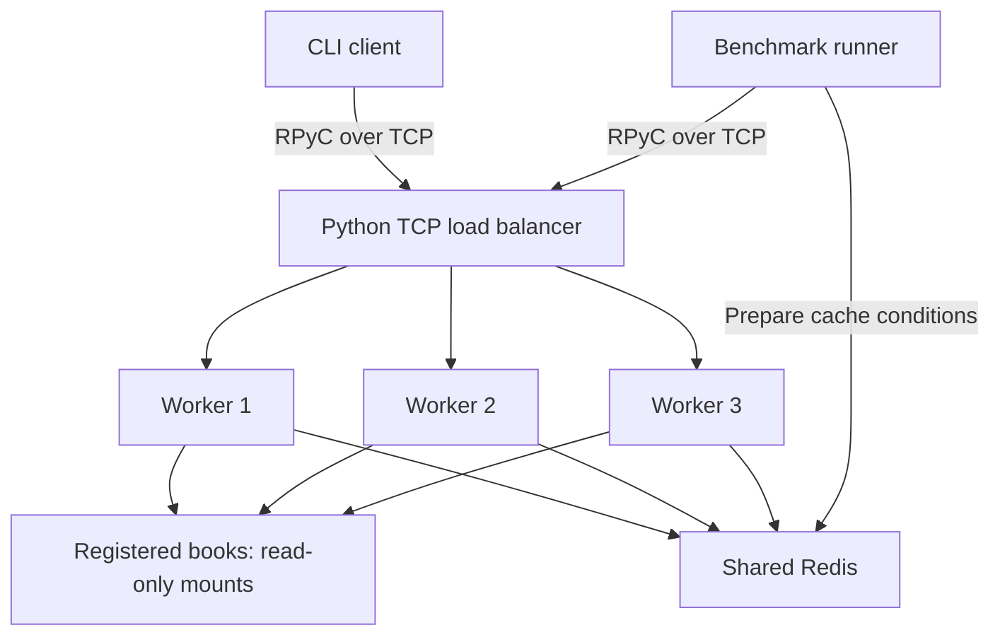

# Distributed word-count system

A Python word-count service developed in phases for the Architecture of Distributed Systems lab at Eindhoven University of Technology. Clients request the number of occurrences of a keyword in a registered server-side text document. The current implementation uses RPyC for client-server communication, Redis for result caching and keyword-popularity statistics, and Docker Compose for deployment.

Phases 1-3 are complete: the project includes the architectural design, a single-worker baseline, three explicit workers behind a custom TCP load balancer, and a comparison of two dynamic balancing algorithms. Phase 4 will add worker health monitoring and failure recovery. The preserved single-worker deployment uses `compose.yaml`; the current three-worker deployment uses `compose.phase3.yaml`.

## Current architecture



Each worker validates the query and checks the shared Redis cache. On a cache miss, it reads the registered book, removes the Gutenberg wrapper, counts matching tokens, and caches the result. A cache hit returns the saved count without scanning the book. Redis entries expire after one hour. Result keys include the extracted document's SHA-256 hash, counting-rule version, and normalized keyword.

The balancer selects a worker when a client opens a connection, then forwards the TCP byte stream in both directions. It does not decode RPyC requests or call worker RPC methods. A persistent connection stays on its selected worker; routing is per connection, not per RPC call. Workers share the same document collection and Redis result keys.

An internal HTTP endpoint on each worker reports query-duration metrics. The balancer polls these metrics for both algorithms. Worker telemetry is separate from the RPyC data stream.

Redis failures trigger basic cache bypass, allowing the worker to compute counts directly. A cooldown/circuit breaker is a planned extension. Popularity statistics are best effort and may omit queries during outages. Redis persistence is disabled in the current local configuration, so restarting its process clears cached results and statistics.

## Requirements

- Docker Desktop with the engine running, or Docker Engine with Docker Compose.
- Git for cloning and version history.
- Internet access for the initial image, dependency, and sample-book downloads.

Python runs inside containers; a host Python installation is not required. Commands below run from the repository root and use macOS/Linux shell syntax.

## Get the sample books

Create the data directory if needed:

```bash
mkdir -p data
```

On macOS, use `/usr/bin/curl` to select the system command explicitly:

```bash
/usr/bin/curl -fL "https://raw.githubusercontent.com/GITenberg/Alice-s-Adventures-in-Wonderland_11/master/11-0.txt" -o data/alice_in_wonderland.txt
/usr/bin/curl -fL "https://raw.githubusercontent.com/GITenberg/The-Adventures-of-Sherlock-Holmes_1661/master/1661.txt" -o data/sherlock_holmes.txt
/usr/bin/curl -fL "https://raw.githubusercontent.com/GITenberg/War-and-Peace_2600/master/2600-0.txt" -o data/war_and_peace.txt
```

On Linux, use `curl` if `/usr/bin/curl` is not its installation location. Existing sample files do not need to be downloaded again. Preserve their original notices. See [text sources](data/SOURCES.md).

| Document ID | Filename |
|---|---|
| `alice` | `alice_in_wonderland.txt` |
| `sherlock` | `sherlock_holmes.txt` |
| `war_and_peace` | `war_and_peace.txt` |

## Start the three-worker service

Stop the single-worker deployment before switching to Phase 3 in the same Compose project:

```bash
docker compose down
export LB_ALGORITHM=least_connections
export WORKER1_DELAY_MS=0
docker compose -f compose.phase3.yaml config
docker compose -f compose.phase3.yaml up --build -d --wait redis server1 server2 server3 balancer
docker compose -f compose.phase3.yaml ps
```

Expect five healthy services: Redis, three workers, and the balancer. Each worker verifies all three documents at startup. The internal ports are 18860 for the proxy, 18861 for each worker's RPyC service, 18862 for balancer status, and 18863 for each worker's HTTP metrics. Redis uses port 6379. None of these ports is published to the laptop by this configuration.

Stopping Redis clears its temporary cache and popularity statistics. Saved experiment files are preserved.

## Load-balancing algorithms

| Policy | Selection rule |
|---|---|
| `least_connections` | Choose the worker with the fewest active proxied connections; rotate between tied workers. |
| `estimated_response_time` | Choose the smallest estimated query duration multiplied by `(active_connections + 1)`, with initial sampling and periodic exploration. |

Response-time estimates use a worker-reported exponentially weighted moving average of count-method duration. They include optional artificial delay but exclude network and connection setup time. The score is a heuristic, not a direct measurement of client end-to-end latency. Stale or missing metrics use a fallback estimate; they do not exclude a worker.

Switch algorithms by recreating the balancer with the selected environment value:

```bash
export LB_ALGORITHM=estimated_response_time
docker compose -f compose.phase3.yaml up -d --wait balancer
```

Set `LB_ALGORITHM=least_connections` and repeat the command to switch back. `WORKER1_DELAY_MS` injects an artificial count-method delay in worker 1 for controlled experiments; it defaults to zero. Recreate `server1` after changing that variable.

See the [TCP proxy and least-connections design](docs/phase3-least-connections.md) and [response-time policy](docs/phase3-response-time.md) for implementation details. These notes describe the individual implementation increments; the [completed benchmark comparison](docs/phase3-benchmark-comparison.md) records the final experiments.

## Query a document

```bash
docker compose -f compose.phase3.yaml run --rm client query alice rabbit
```

For the book edition used in the recorded experiment, the count is 47. The JSON response includes the worker ID, request ID, normalized keyword, count, cache status, and timing measurements.

Repeat the query to observe `cache_status: hit`. The first query produces `miss` only if that result is not already cached. `bypass` means a Redis result read/write failed and counting proceeded without the cache. A `statistics_recorded` field reports whether this query's popularity increment succeeded.

List the most frequently requested keywords:

```bash
docker compose -f compose.phase3.yaml run --rm client top --limit 5
```

Popularity counts query invocations across all books, not occurrences inside a book. Health checks and the `top` command do not increase popularity. Benchmark preflight and benchmark queries do increase it.

## Check request distribution

```bash
docker compose -f compose.phase3.yaml run --rm --no-deps -T --interactive=false distribution --requests 60 --interval 0.1 --summary-only
docker compose -f compose.phase3.yaml exec -T balancer python -m wordcount.balancer_status --host 127.0.0.1
```

The distribution helper checks each response against a locally calculated count and prints totals by worker. Its interval is a delay after each response, so this is a sequential demonstration. It does not measure concurrent balancing performance. With few overlapping connections, least connections often chooses between zero-active-connection ties. The benchmark below supplies overlapping requests.

Balancer status includes active connections, cumulative selections, connection failures, and worker timing estimates. `selected_connections` counts sessions, not completed queries. Metrics-error counters are cumulative.

Worker health monitoring is disabled in Phase 3. Docker healthchecks report container readiness, but the balancer does not use their results to exclude failed workers. A failed metrics poll also does not remove a worker. Stopping a worker can therefore cause a client-visible connection error. Failure exclusion and automatic re-admission are Phase 4 work.

## Counting rules

- Case-insensitive matching of complete English tokens.
- Tokens use ASCII letters with optional internal apostrophes; curly apostrophes are normalized to straight apostrophes.
- Hyphens, digits, underscores, and other punctuation separate tokens. No stemming or multilingual tokenization is provided.
- Keywords are trimmed and must contain exactly one valid token. Phrases, empty keywords, and surrounding punctuation are rejected.
- Recognized Gutenberg start/end markers and text outside them are excluded. Titles and contents inside the markers remain included. Incomplete or reversed markers produce an error.
- Document IDs come from an allowlist. Clients cannot request arbitrary filesystem paths.

For example, keyword `cat` matches twice in `Cat, cat! Cats concatenate.`. Keyword `don't` is one token and does not match `don`.

Documents must remain unchanged while workers are running. After changing the collection, recreate all workers so their startup hashes agree with the files they count.

## Tests

After building the image:

```bash
docker run --rm --mount "type=bind,source=$PWD,target=/app,readonly" -w /app wordcount-lab:phase3 python -B -m unittest discover -s tests -v
```

The current suite defines 52 tests covering counting, document validation, RPC behavior, cache decisions, benchmark accounting, connection selection, TCP forwarding, worker metrics, and response-time scoring. RPC and proxy tests use local TCP connections and small temporary documents. Automated cache tests mock the Redis command boundary; check actual Redis behavior using the query and popularity commands above. The suite does not require the sample-book text to have a particular edition.

## Benchmarks

Create the results directory and set IDs for writable output files:

```bash
mkdir -p results
export BENCHMARK_UID="$(id -u)"
export BENCHMARK_GID="$(id -g)"
```

### Phase 3: compare both algorithms

Start the Phase 3 deployment as described above, with worker 1's artificial delay set to zero. Run the algorithms sequentially using the same workload parameters as the recorded Phase 2 baseline:

```bash
export WORKER1_DELAY_MS=0

for algorithm in least_connections estimated_response_time; do
  export LB_ALGORITHM="$algorithm"

  docker compose -f compose.phase3.yaml up -d --wait \
    redis server1 server2 server3 balancer || break

  docker compose -f compose.phase3.yaml run --rm --no-deps \
    -T --interactive=false benchmark \
    --rates 10 20 30 40 50 \
    --duration 30 \
    --repeats 3 \
    --mode both \
    --workers 32 \
    --max-pending 128 \
    --seed 2026 \
    --label "phase3_${algorithm}" || break
done
```

Allow about 30-40 minutes for both configurations, including setup and draining outstanding requests. Keep the computer awake and avoid unrelated heavy workloads. `-T --interactive=false` also allows these tool containers to run without terminal input when redirected or started in the background.

### Phase 2: reproduce the single-worker baseline

Switch back to the single-worker deployment:

```bash
docker compose -f compose.phase3.yaml down
docker compose up --build -d --wait redis server
```

Run a short setup check:

```bash
docker compose run --rm benchmark --rates 10 20 --duration 3 --repeats 1 --label phase2_smoke
```

Run the five-rate experiment:

```bash
docker compose run --rm benchmark --rates 10 20 30 40 50 --duration 30 --repeats 3 --label phase2_full
```

Each full experiment offers traffic for approximately 15 minutes, plus setup and outstanding-request drain time. It measures cached and uncached workloads. Each query uses a new connection. Arrivals are scheduled independently of response completion, with a bounded backlog; excess arrivals remain recorded as `client_capacity_drop`.

The runner performs a Redis/worker preflight and writes a unique results directory containing raw request CSVs, `summary.csv`, `metadata.json`, and mean-latency, p99-latency, and failure-rate plots. Keep the source data even when a run reports errors.

Primary RPC latency excludes connection setup, remote-method lookup, and waiting for a client thread. End-to-end timing and scheduling delay are recorded separately. Latency plots include correct successful requests only; always inspect drops, throughput, and cache-condition mismatches alongside them.

See [the complete benchmark procedure](docs/phase2-benchmark.md) for workload definitions, host-details commands, output fields, and plot regeneration.

## Recorded Phase 2 results

The run `phase2_full_20261117T145144Z_61fb2e` tested 10–50 requests per second, 30 seconds per condition, and three repetitions.

| Workload | Observed behavior |
|---|---|
| Cached | All 13,500 offered requests succeeded. Offered rates were sustained through 50 requests/s; mean RPC latency was approximately 0.70–0.90 ms. |
| Uncached at 10–20 requests/s | No failures/drops; achieved throughput approximately matched offered rate. |
| Uncached at 30–50 requests/s | Achieved throughput stayed near 20 requests/s. The bounded client backlog filled, with failed/dropped fractions of 18.15%, 39.47%, and 50.78%. |

All conditions reported zero cache-status mismatches among successful responses. The summary reports that every sent query succeeded; the inspected 50 requests/s trace confirms that its unsuccessful entries were all pre-send client-capacity drops. These results describe the current single-worker setup and benchmark settings, not an independently isolated worker capacity limit.

See [the results and limitations](docs/phase2-results.md) for the full table, figures, evidence links, and interpretation. The cached and uncached modes use different keyword selections, so their difference is not an isolated cache-speedup measurement on identical queries.

## Recorded Phase 3 results

Both Phase 3 configurations offered 27,000 requests and completed all of them, with zero cache-condition mismatches. Recorded rates, repeat counts, document hashes, random seed, client limits, and benchmark source match the Phase 2 baseline. Worker telemetry is enabled in Phase 3 and disabled in the Phase 2 deployment; these runs also took place on different dates.

The following comparison is for **40 uncached requests/s**. Latencies and throughput average the three repeat statistics; success counts sum the three repeats. The p99 column averages per-repeat p99 values rather than calculating a pooled percentile.

| Configuration | Successful / offered | Achieved req/s | Mean RPC latency (ms) | Mean repeat p99 RPC (ms) |
|---|---:|---:|---:|---:|
| Phase 2: single worker | 2,179 / 3,600 | 20.20 | 346.38 | 943.97 |
| Phase 3: least connections | 3,600 / 3,600 | 39.85 | 56.24 | 159.60 |
| Phase 3: estimated response time | 3,600 / 3,600 | 39.78 | 98.39 | 436.29 |

Both three-worker configurations improved observed uncached capacity relative to the single-worker deployment. Least connections had lower latency at 40 uncached requests/s in these runs. At an offered 50 uncached requests/s, both completed every request but fell behind the offered rate: achieved throughput was 47.58 and 46.40 requests/s, respectively, with increased latency and scheduling delay. Zero failures does not mean either configuration sustained 50 requests/s without a backlog.

For cached queries, all configurations sustained the tested rates. Adding a balancer increased mean end-to-end latency at every recorded cached rate. Successful-request latency must also be read alongside drops: the baseline's lower successful-only RPC latency at 50 uncached requests/s does not imply better overall performance when 50.78% of its offered requests were unsuccessful. These results do not establish a threefold speedup or a universally better algorithm.

Separate slow-worker demonstrations sent fewer requests to the delayed worker under both policies. The sequential response-time demonstration and concurrent least-connections demonstration used different workloads, so their totals are routing evidence rather than an algorithm performance ranking.

See the [full Phase 2/3 comparison](docs/phase3-benchmark-comparison.md), [comparison figures and source summaries](docs/evidence/phase3/benchmarks/), and [distribution and failure-baseline logs](docs/evidence/phase3/). Original per-request measurements remain in `results/`.

## Repository organization

| Path | Purpose |
|---|---|
| `wordcount/counting.py` | Counting rules and registered-document loading |
| `wordcount/server.py` | RPyC worker and query handling |
| `wordcount/client.py` | Query, health, and popularity CLI |
| `wordcount/cache.py` | Redis result keys and popularity commands |
| `wordcount/load_balancer.py` | TCP forwarding and both dynamic routing policies |
| `wordcount/balancer_status.py` | Read the balancer's internal status endpoint |
| `wordcount/check_distribution.py` | Verify query results and show worker totals |
| `wordcount/worker_metrics.py` | Worker query-duration measurements and HTTP telemetry |
| `wordcount/benchmark.py` | Workload generation, measurements, summaries, and plots |
| `wordcount/plot_results.py` | Regenerate plots from a saved summary |
| `tests/` | Counting, RPC, cache, benchmark, proxy, and metrics tests |
| `data/` | Sample books and source credits |
| `docs/` | Architecture, implementation notes, procedures, and results |
| `results/` | Recorded experiment evidence |
| `Dockerfile` | Python application image |
| `compose.yaml` | Preserved single-worker Phase 2 deployment |
| `compose.phase3.yaml` | Three workers, shared Redis, balancer, and client tools |
| `requirements.txt` | Pinned Python dependencies |

## Logs and shutdown

```bash
docker compose -f compose.phase3.yaml logs --tail=20 balancer server1 server2 server3
docker compose -f compose.phase3.yaml logs --tail=20 redis
docker compose -f compose.phase3.yaml down
```

Shutdown removes this project's containers and Compose network, not repository files. Cache entries and popularity totals are temporary in the current Redis configuration.

## Troubleshooting

- **Cannot connect to the Docker engine:** start Docker Desktop and check `docker info`.
- **Missing registered document at startup:** check filenames under `data/`, then recreate the affected workers.
- **Changes do not appear in a Phase 3 container:** run `docker compose -f compose.phase3.yaml up --build -d --wait redis server1 server2 server3 balancer`; the source is copied into the image.
- **Benchmark cannot write results:** create `results/` and export the benchmark UID/GID in the terminal running Compose.
- **Unexpected cache status:** check worker/Redis health and compare the files mounted into the worker and benchmark. Do not interpret the run as the intended cache condition until resolved.
- **Benchmark reports `client_capacity_drop`:** inspect offered rate, achieved throughput, client scheduling delay, and failed/dropped fraction. Preserve the run; a drop is an overload observation, not automatically a wrong-count response.
- **Background tool job reports `suspended (tty input)`:** use `-T --interactive=false` with `docker compose run` before the service name.
- **A stopped worker causes EOF or connection errors:** this is the recorded Phase 3 limitation. Metrics polling does not provide worker failure exclusion. Restore the worker; automatic handling is planned for Phase 4.
- **No PNG files:** wait for the benchmark to finish and open its timestamped subdirectory under `results/`. If plotting failed after measurement, retain the CSVs and use the documented plot-regeneration command.

## Phase history and planned work

One repository holds all phases. Commit messages include phase numbers, such as `feat(phase-2): add Redis caching`. Tags are created after verifying a milestone and completing its documentation.

| Milestone | Scope |
|---|---|
| Phase 1, complete | Requirements, stakeholders, architecture, and style tradeoffs |
| Phase 2, complete | Single-worker RPC service, Redis cache, and latency evaluation |
| Phase 3, complete | Three explicit workers, TCP balancing with both algorithms, distribution tests, and latency/throughput comparison |
| Phase 4, planned | Periodic worker checks, failure exclusion, automatic re-admission, bounded client retries, and failure/recovery tests for both algorithms |

After the core fault-tolerance work, planned extensions are a second balancer with client failover and a Redis-bypass cooldown. The agreed Redis approach keeps one instance, computes counts directly during outages, and resumes caching after recovery. The cooldown and second-balancer failover are not implemented yet.

A worker or balancer crash can interrupt an existing connection. The current Phase 3 client does not automatically retry failed queries. Planned retries will reconnect rather than migrate TCP sessions or replay a partially forwarded RPC byte stream. Whole-host failure tolerance is outside the current single-machine lab deployment. Authentication and transport encryption are not implemented in this local setup.

This README documents the completed Phase 3 state. Phase 4 and the listed extensions remain planned work.
