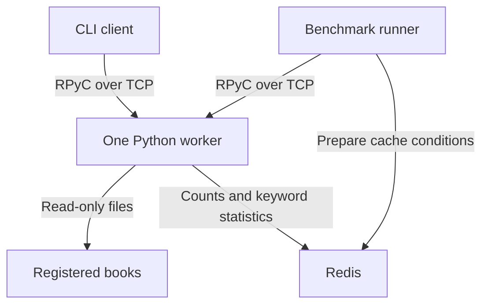

# Distributed word-count system

A Python word-count service developed in phases for the Architecture of Distributed Systems lab at Eindhoven University of Technology. Clients request the number of occurrences of a keyword in a registered server-side text document. The current implementation uses RPyC for client-server communication, Redis for result caching and keyword-popularity statistics, and Docker Compose for deployment.

Phase 2 implements one worker and a repeatable latency benchmark. Three-worker load balancing and fault tolerance are planned for Phases 3 and 4.

## Current architecture



The worker validates the query and checks Redis. On a cache miss, it reads the registered book, removes the Gutenberg wrapper, counts matching tokens, and caches the result. A cache hit returns the saved count without scanning the book. Redis entries expire after one hour. Result keys include the extracted document's SHA-256 hash, counting-rule version, and normalized keyword.

Redis failures trigger basic cache bypass, allowing the worker to compute counts directly. A cooldown/circuit breaker is planned for Phase 4. Popularity statistics are best effort and may omit queries during outages. Redis persistence is disabled in the current local configuration, so restarting its process clears cached results and statistics.

## Requirements

- Docker Desktop with the engine running, or Docker Engine with Docker Compose.
- Git for cloning and version history.
- Internet access for the initial image, dependency, and sample-book downloads.

Python runs inside containers; a host Python installation is not required. Commands below run from the repository root and use macOS/Linux shell syntax.

## Get the sample books

Create the data directory if needed:

```bash
mkdir -p data
```

On macOS, use `/usr/bin/curl` to select the system command explicitly:

```bash
/usr/bin/curl -fL "https://raw.githubusercontent.com/GITenberg/Alice-s-Adventures-in-Wonderland_11/master/11-0.txt" -o data/alice_in_wonderland.txt
/usr/bin/curl -fL "https://raw.githubusercontent.com/GITenberg/The-Adventures-of-Sherlock-Holmes_1661/master/1661.txt" -o data/sherlock_holmes.txt
/usr/bin/curl -fL "https://raw.githubusercontent.com/GITenberg/War-and-Peace_2600/master/2600-0.txt" -o data/war_and_peace.txt
```

On Linux, use `curl` if `/usr/bin/curl` is not its installation location. Existing sample files do not need to be downloaded again. Preserve their original notices. See [text sources](data/SOURCES.md).

| Document ID | Filename |
|---|---|
| `alice` | `alice_in_wonderland.txt` |
| `sherlock` | `sherlock_holmes.txt` |
| `war_and_peace` | `war_and_peace.txt` |

## Start the service

```bash
docker compose config
docker compose up --build -d --wait redis server
docker compose ps
```

Both services should become healthy. The worker verifies all three documents at startup. RPyC and Redis ports are reachable inside the Compose network; neither is published to the laptop by this configuration.

## Query a document

```bash
docker compose run --rm client query alice rabbit
```

For the book edition used in the recorded experiment, the count is 47. The JSON response includes the worker ID, request ID, normalized keyword, count, cache status, and timing measurements.

Repeat the query to observe `cache_status: hit`. The first query produces `miss` only if that result is not already cached. `bypass` means a Redis result read/write failed and counting proceeded without the cache. A `statistics_recorded` field reports whether this query's popularity increment succeeded.

List the most frequently requested keywords:

```bash
docker compose run --rm client top --limit 5
```

Popularity counts query invocations across all books, not occurrences inside a book. Health checks and the `top` command do not increase popularity. Benchmark preflight and benchmark queries do increase it.

## Counting rules

- Case-insensitive matching of complete English tokens.
- Tokens use ASCII letters with optional internal apostrophes; curly apostrophes are normalized to straight apostrophes.
- Hyphens, digits, underscores, and other punctuation separate tokens. No stemming or multilingual tokenization is provided.
- Keywords are trimmed and must contain exactly one valid token. Phrases, empty keywords, and surrounding punctuation are rejected.
- Recognized Gutenberg start/end markers and text outside them are excluded. Titles and contents inside the markers remain included. Incomplete or reversed markers produce an error.
- Document IDs come from an allowlist. Clients cannot request arbitrary filesystem paths.

For example, keyword `cat` matches twice in `Cat, cat! Cats concatenate.`. Keyword `don't` is one token and does not match `don`.

Documents must remain unchanged while the worker is running. After changing the collection, recreate the worker so its startup hashes agree with the files it counts.

## Tests

After building the image:

```bash
docker run --rm --mount "type=bind,source=$PWD,target=/app,readonly" -w /app wordcount-lab:phase2 python -B -m unittest discover -s tests -v
```

The current suite contains 33 tests covering counting, document validation, RPC behavior, cache decisions, and benchmark accounting. RPC tests use real TCP connections and small temporary documents. Automated cache tests mock the Redis command boundary; check actual Redis behavior using the query and popularity commands above. The suite does not require the sample-book text to have a particular edition.

## Benchmark

Create the results directory and set IDs for writable output files:

```bash
mkdir -p results
export BENCHMARK_UID="$(id -u)"
export BENCHMARK_GID="$(id -g)"
```

Run a short setup check:

```bash
docker compose run --rm benchmark --rates 10 20 --duration 3 --repeats 1 --label phase2_smoke
```

Run the five-rate experiment:

```bash
docker compose run --rm benchmark --rates 10 20 30 40 50 --duration 30 --repeats 3 --label phase2_full
```

The full experiment offers traffic for approximately 15 minutes, plus setup and outstanding-request drain time. It measures cached and uncached workloads. Each query uses a new connection. Arrivals are scheduled independently of response completion, with a bounded backlog; excess arrivals remain recorded as `client_capacity_drop`.

The runner performs a Redis/worker preflight and writes a unique results directory containing raw request CSVs, `summary.csv`, `metadata.json`, and mean-latency, p99-latency, and failure-rate plots. Keep the source data even when a run reports errors.

Primary RPC latency excludes connection setup, remote-method lookup, and waiting for a client thread. End-to-end timing and scheduling delay are recorded separately. Latency plots include correct successful requests only; always inspect drops, throughput, and cache-condition mismatches alongside them.

See [the complete benchmark procedure](docs/phase2-benchmark.md) for workload definitions, host-details commands, output fields, and plot regeneration.

## Recorded Phase 2 results

The run `phase2_full_20261117T145144Z_61fb2e` tested 10–50 requests per second, 30 seconds per condition, and three repetitions.

| Workload | Observed behavior |
|---|---|
| Cached | All 13,500 offered requests succeeded. Offered rates were sustained through 50 requests/s; mean RPC latency was approximately 0.70–0.90 ms. |
| Uncached at 10–20 requests/s | No failures/drops; achieved throughput approximately matched offered rate. |
| Uncached at 30–50 requests/s | Achieved throughput stayed near 20 requests/s. The bounded client backlog filled, with failed/dropped fractions of 18.15%, 39.47%, and 50.78%. |

All conditions reported zero cache-status mismatches among successful responses. The summary reports that every sent query succeeded; the inspected 50 requests/s trace confirms that its unsuccessful entries were all pre-send client-capacity drops. These results describe the current single-worker setup and benchmark settings, not an independently isolated worker capacity limit.

See [the results and limitations](docs/phase2-results.md) for the full table, figures, evidence links, and interpretation. The cached and uncached modes use different keyword selections, so their difference is not an isolated cache-speedup measurement on identical queries.

## Repository organization

| Path | Purpose |
|---|---|
| `wordcount/counting.py` | Counting rules and registered-document loading |
| `wordcount/server.py` | RPyC worker and query handling |
| `wordcount/client.py` | Query, health, and popularity CLI |
| `wordcount/cache.py` | Redis result keys and popularity commands |
| `wordcount/benchmark.py` | Workload generation, measurements, summaries, and plots |
| `wordcount/plot_results.py` | Regenerate plots from a saved summary |
| `tests/` | Correctness, RPC, cache, and benchmark tests |
| `data/` | Sample books and source credits |
| `docs/` | Architecture, implementation notes, procedures, and results |
| `results/` | Recorded experiment evidence |
| `Dockerfile` | Python application image |
| `compose.yaml` | Container definitions and networking |
| `requirements.txt` | Pinned Python dependencies |

## Logs and shutdown

```bash
docker compose logs --tail=20 server
docker compose logs --tail=20 redis
docker compose down
```

Shutdown removes this project's containers and Compose network, not repository files. Cache entries and popularity totals are temporary in the current Redis configuration.

## Troubleshooting

- **Cannot connect to the Docker engine:** start Docker Desktop and check `docker info`.
- **Missing registered document at startup:** check filenames under `data/`, then recreate the worker.
- **Changes do not appear in a container:** run `docker compose up --build -d --wait redis server`; the source is copied into the image.
- **Benchmark cannot write results:** create `results/` and export the benchmark UID/GID in the terminal running Compose.
- **Unexpected cache status:** check worker/Redis health and compare the files mounted into the worker and benchmark. Do not interpret the run as the intended cache condition until resolved.
- **Benchmark reports `client_capacity_drop`:** inspect offered rate, achieved throughput, client scheduling delay, and failed/dropped fraction. Preserve the run; a drop is an overload observation, not automatically a wrong-count response.
- **No PNG files:** wait for the benchmark to finish and open its timestamped subdirectory under `results/`. If plotting failed after measurement, retain the CSVs and use the documented plot-regeneration command.

## Phase history and planned work

One repository holds all phases. Commit messages include phase numbers, such as `feat(phase-2): add Redis caching`. Tags are created after verifying a milestone and completing its documentation.

| Milestone | Scope |
|---|---|
| Phase 1 | Requirements, stakeholders, architecture, and style tradeoffs |
| Phase 2 | Single-worker RPC service, Redis cache, and latency evaluation |
| Phase 3, planned | Three explicit workers, custom TCP load balancer, least connections and estimated least response time |
| Phase 4, planned | Worker monitoring and recovery, followed by two-balancer client failover and Redis-bypass cooldown |

A worker or balancer crash may interrupt an existing connection; future retries will reconnect rather than migrate TCP sessions. Whole-host failure tolerance is outside the current single-machine lab deployment. Authentication and transport encryption are not implemented in this local setup.

This README documents the implemented Phase 2 state. Planned features are not claims of completed functionality.
