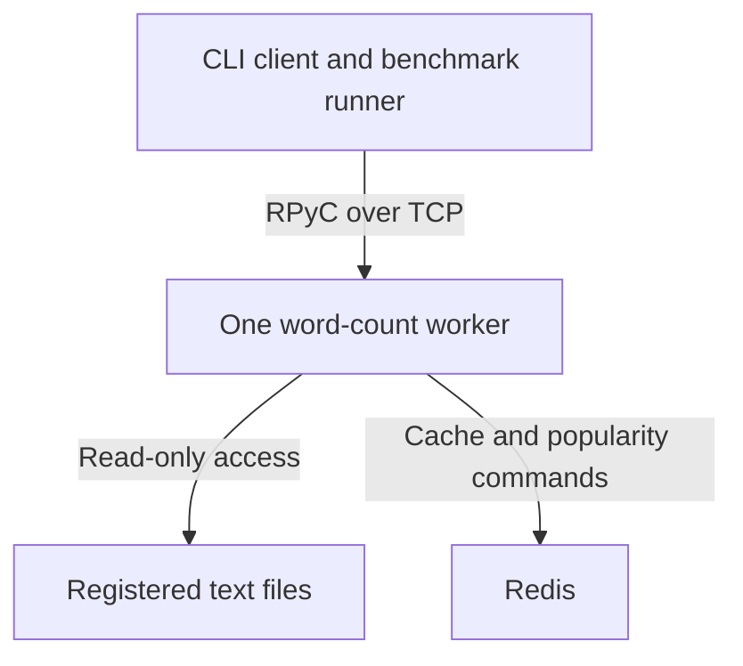
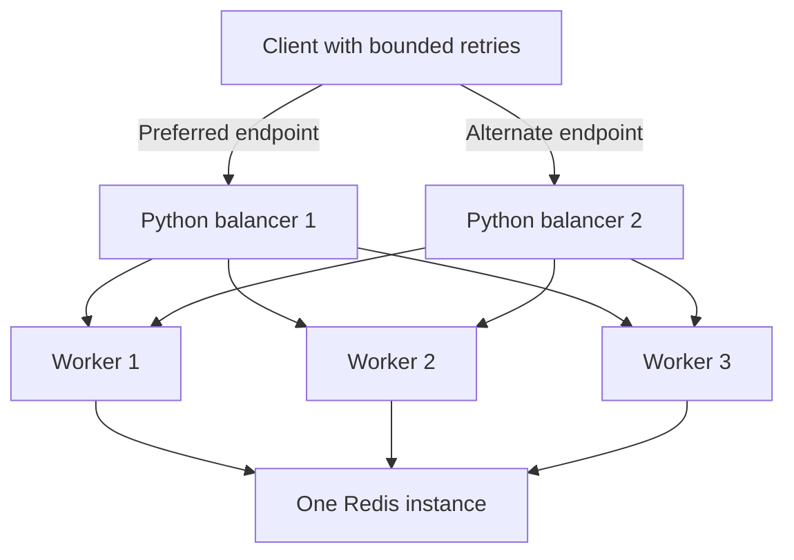

# Architecture and requirements

Status: design specification. The components and recovery targets below have not yet been implemented or measured.

## Purpose and scope

Build a distributed service that counts occurrences of one keyword in a text document already stored on the servers. Develop the system incrementally using Python, RPyC, Redis, and Docker Compose. Preserve phase milestones with Git tags in one repository.

The system uses a client-server architecture. Clients submit queries; workers perform counting. A custom TCP proxy distributes connections to workers. Redis stores reusable results and keyword-popularity statistics.

## Stakeholders

| Stakeholder | Role and needs |
|---|---|
| Service user | Submits a document ID and keyword; needs correct results, clear errors, and bounded waiting. |
| Service operator | Deploys the system, inspects logs, runs experiments, and manages failures; needs reproducible configuration and observable recovery. |

## Functional requirements

| ID | Requirement | Verification |
|---|---|---|
| FR1 | Accept a registered document ID and one keyword, returning the number of matching tokens. | Compare responses against known expected counts. |
| FR2 | Return a clear validation error for invalid keywords or unknown document IDs. Never interpret a document ID as an arbitrary filesystem path. | Submit malformed keywords, unknown IDs, and path-traversal strings. |
| FR3 | Reuse Redis results for identical document content, normalized keywords, and counting-rule versions. | Repeat a query and observe a cache hit. |
| FR4 | Record keyword popularity while Redis is available and expose a top-keywords query. Statistics are best effort: retries may count more than once and outages may omit requests. | Run a controlled workload without failures or retries and compare expected rankings. |
| FR5 | Distribute connections across three explicitly configured workers using either least connections or estimated least response time. | Inspect worker IDs and routing logs under concurrent traffic. |
| FR6 | Detect worker failure, exclude the failed worker, and automatically reuse it after successful readiness checks. | Stop and restart a worker during traffic for both algorithms. |
| FR7 | Allow the client to reconnect to a second balancer when its selected balancer fails. | Stop the selected balancer during traffic. |
| FR8 | Continue returning counts when Redis is unavailable and automatically resume cache use after recovery. | Stop and restart Redis during traffic. |

## Non-functional requirements

| ID | Requirement or initial acceptance target | Verification |
|---|---|---|
| NFR1 | All successful queries return exactly the count defined by the counting rules, with or without caching and retries. | Correctness tests and failure experiments. |
| NFR2 | In the local stop/start experiment, exclude a failed worker within 5 seconds and re-admit a ready worker within 5 seconds. These are initial targets, not measured guarantees. | Timestamp checks and routing events. |
| NFR3 | Set a 10-second overall deadline per logical client query, including connection attempts and retries; allow at most two retries after the first attempt. Report an error when the budget is exhausted. | Test unreachable endpoints and interrupted calls. |
| NFR4 | While the cache circuit is closed, spend at most 200 ms per Redis command attempt. After a connection failure or timeout, bypass Redis for 5 seconds before a single controlled recovery attempt. | Measure request timing and inspect cache-state logs during an outage. |
| NFR5 | Support simultaneous client connections. Measure mean and p99 RPC latency, achieved throughput, errors, retries, and worker distribution at five offered rates. | Repeat a seeded workload at 10, 20, 30, 40, and 50 requests/second initially. |
| NFR6 | Deploy each experiment configuration through documented Docker Compose commands and retain dependency versions and experiment settings. | Reproduce the documented setup from a clean checkout. |

Recovery experiments assume one stopped container at a time, at least one usable balancer and worker, and a workload below the surviving workers' measured capacity. A stop/start experiment does not establish behavior under every network partition.

## Counting rules

- Documents are registered UTF-8 text files shared read-only across workers. Clients send a document ID, not document contents or a filesystem path.
- Version 1 supports English tokens consisting of ASCII letters, with optional internal straight or curly apostrophes. Hyphens and digits separate tokens. Normalize curly apostrophes to straight apostrophes and ASCII letters to lowercase before comparison.
- A keyword, after trimming surrounding whitespace and normalizing, must be exactly one valid token. Reject empty strings, phrases, and surrounding punctuation.
- Match complete tokens, not substrings: `cat` does not match `cats` or `concatenate`.
- Keep contractions as one token: `don't` does not match the keyword `don`.
- Return zero when a valid keyword does not occur.
- Unicode-language tokenization and stemming are outside the initial scope.

Example: for `Cat, cat! Cats concatenate.`, keyword `CAT` returns `2`.

Cache identity includes a counting-rule version, a hash of the document contents, and the normalized keyword. Document versions and hashes are prepared at startup rather than recomputed on every cache lookup. Changing the document collection requires restarting workers with the same updated collection.

## Phase 2 architecture

The worker validates the query, checks Redis, counts on a cache miss, and caches the result. Responses include count, document ID, normalized keyword, worker ID, request ID, and cache status. Cache status distinguishes a hit, a miss, and bypass during unavailability.

## Final architecture

Each worker also reads the same registered text collection. Both balancers independently poll internal worker readiness and timing endpoints; these monitoring connections are separate from the proxied RPyC stream. The diagram shows the data path; monitoring and file-access connectors are omitted here for readability.

The balancers forward bytes in both directions without decoding or originating RPyC calls. A connection remains attached to its selected worker. A worker or balancer failure can interrupt an in-flight RPC; the client reconnects and retries within its deadline. A retry preserves the logical request ID for tracing. Counting is repeatable, but this does not guarantee exactly-once statistics.

For initial experiments, each connection carries one count query. Record connection-setup time separately from RPC latency and also retain end-to-end logical-query latency, including retries. Long-lived connections remain possible, but their individual calls are not rebalanced.

### Balancing policies

- **Least connections:** choose the healthy worker with the fewest active proxied connections, rotating ties. Counts are local to each balancer; they are not global counts across both balancers.
- **Estimated least response time:** use a worker-reported exponentially weighted moving average of completed query-processing times, with a penalty based on locally active connections. Document the exact score when implemented. Include bounded sampling of workers with missing or old measurements so a previously slow worker can recover traffic. This estimates worker responsiveness rather than directly measuring full client-observed RPC latency.

Use one balancer for the controlled Phase 3 comparison. Use both when evaluating balancer failover. Keep an option to disable worker health monitoring to reproduce Phase 3 failure behavior before Phase 4 is enabled.

### Redis failure behavior

Redis is a cache dependency, not the source of document truth. A short timeout and circuit breaker allow workers to bypass it during outages. A half-open recovery attempt determines whether cache use can resume. Word counting remains available while popularity statistics become incomplete. No Redis replication or Sentinel is planned.

## Alternative architectural styles

### Peer-to-peer

Peers could store documents and answer counting queries without a dedicated worker tier. This could spread ownership across machines, but would require document discovery, routing, and version coordination. Central ownership of this project's fixed document collection makes client-server simpler to implement and evaluate.

### Publish-subscribe

Clients could publish query jobs, workers could consume them, and results could be delivered on reply channels. This would support queued background processing and absorb bursts, but would introduce a broker, correlation IDs, and delivery/retry semantics. It is less direct for this project's synchronous request-response API.

## Evaluation and limits

Preserve raw measurements, workload seeds, document versions, machine details, cache state, and configuration alongside selected figures. Separate cached and uncached workloads. Report failures rather than excluding them from the results, and distinguish offered load from achieved throughput. Scaling gains must be demonstrated, not assumed.

The project tests process/container failures on one machine. The host, Docker engine, and document storage remain shared failure domains. Balancer failover restores new connections; it does not migrate existing connections. Redis failure preserves counting availability but not complete popularity statistics. The initial deployment is a local lab environment, without a public-service authentication or transport-security guarantee.

## Milestones

| Tag | Intended contents |
|---|---|
| `phase-1` | Requirements and architecture design |
| `phase-2` | Single worker, caching, CLI, and baseline measurements |
| `phase-3` | Three workers, both balancing policies, and comparison results |
| `phase-4` | Worker failure detection, recovery, and experiments for both policies |
| `v1.0.0` | Balancer failover, Redis bypass, complete tests, demonstrations, and README |

Tags are created only when their milestone is complete. The README will distinguish planned behavior from implemented and tested behavior.
