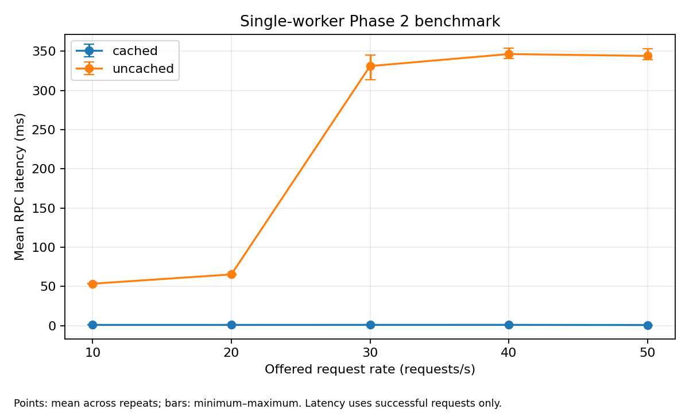
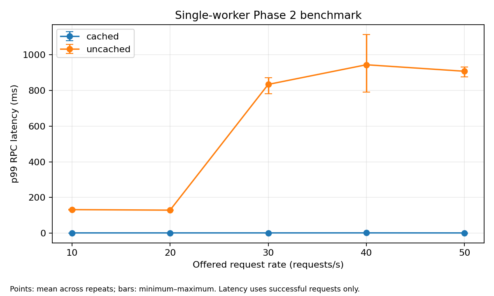
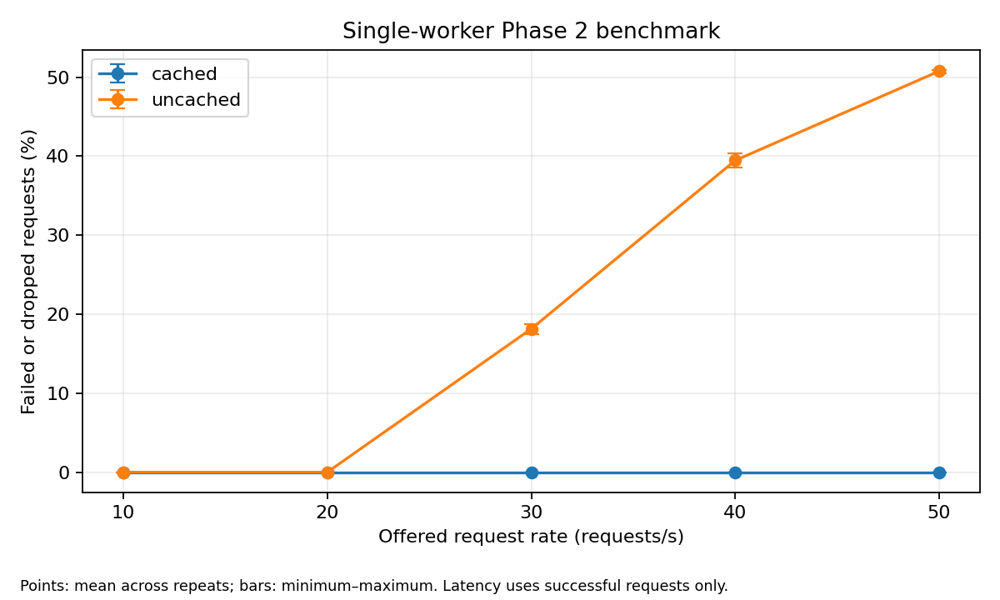

# Phase 2 results: single worker with Redis

## Experiment

Run directory: `results/phase2_full_20261117T145144Z_61fb2e/`.

A Python client issued word-count queries to one RPyC worker with Redis result caching. Requests were offered at 10, 20, 30, 40, and 50 requests per second. Each condition ran for 30 seconds with three repetitions, using seed 2026. The benchmark used 32 client threads and allowed at most 128 running or queued tasks. Each count query opened a new connection; no automatic retries were enabled.

The benchmark tested two workloads:

- Cached: 12 warmed document/keyword pairs, using `the`, `and`, `of`, and `to` in each book.
- Uncached: seeded distinct document/keyword pairs interleaved across the three books. Their exact Redis result keys were removed before each repetition, so each sent query required counting. The worker still wrote newly computed answers to Redis.

These are different keyword workloads. Their latency difference is not a controlled estimate of cache speedup on identical query sequences.

The metadata records Python 3.12.16, RPyC 6.0.2, redis-py 6.4.0, and Matplotlib 3.10.7. The container ran Linux on ARM64. The metadata does not record the Redis server version, CPU model, Docker CPU limit, or memory limit. Host and container-resource details should accompany the run where available; do not infer exact allocations from earlier checks.

The extracted documents contained 26,704 tokens in Alice's Adventures in Wonderland, 105,354 in The Adventures of Sherlock Holmes, and 576,812 in War and Peace under `english-v1`. Content and implementation hashes are recorded in the run metadata.

## Measurement definitions

RPC latency starts immediately before invoking the resolved remote count method and ends when the returned value is received. It excludes connection setup, remote-method lookup, and time waiting for a benchmark thread. This matches the count-invocation timing boundary used by the implementation; it must not be presented as the entire time a user waits.

The benchmark also records end-to-end time from client-task start, scheduling delay, and scheduled-arrival-to-completion time in individual request CSVs. Summary columns include mean and p99 end-to-end time and p99 scheduling delay.

Only successful, correct responses contribute to latency statistics. Failures and client-side drops remain in the offered-request count and are reported separately. Throughput is successful responses divided by observation duration, including outstanding-request drain time when it extends beyond the offered window.

Each table entry below averages the three repeat statistics, except the drop percentage, which is the dropped fraction across the three repeats. The p99 column is the mean of three nearest-rank p99 estimates, not a pooled p99. Plot error bars show the smallest and largest repeat statistic, not confidence intervals.

## Results

| Offered requests/s | Cached mean RPC ms | Cached p99 RPC ms | Uncached mean RPC ms | Uncached p99 RPC ms | Uncached achieved requests/s | Uncached failed/dropped % |
|---:|---:|---:|---:|---:|---:|---:|
| 10 | 0.84 | 1.38 | 53.44 | 131.89 | 9.99 | 0.00 |
| 20 | 0.84 | 1.40 | 65.22 | 128.99 | 19.95 | 0.00 |
| 30 | 0.89 | 1.42 | 331.05 | 833.82 | 20.32 | 18.15 |
| 40 | 0.90 | 1.53 | 346.38 | 943.97 | 20.20 | 39.47 |
| 50 | 0.70 | 1.22 | 344.03 | 907.52 | 20.40 | 50.78 |

All cached runs achieved their offered rates and reported zero failures. All 13,500 cached requests succeeded. The uncached workload offered 13,500 requests, sent 9,304, and reported 9,304 successful responses and 4,196 failures/drops. Every condition reported zero cache-status mismatches among successful responses.

## Interpretation

The cached workload remained responsive across the tested range: mean RPC latency was approximately 0.70–0.90 ms, with no reported failures. This does not establish the maximum cached throughput because rates above 50 requests per second were not tested.

The uncached workload sustained approximately 10 and 20 requests per second without drops. At offered rates of 30–50 requests per second, observed throughput remained near 20 requests per second, scheduling delays grew, and the bounded client backlog filled. The current single-worker system and benchmark configuration could not sustain those offered rates. This observation does not independently isolate worker CPU, protocol overhead, or generator settings as the sole bottleneck.

The apparent high-load latency plateau must be read alongside the increasing drop rate: RPC latency describes only successfully sent queries. It does not account for queries discarded before sending, and it excludes substantial waiting outside the timed count call.

The cached and uncached curves share a linear axis, so the small cached values are difficult to distinguish visually. The numerical table provides those values without requiring a new experiment.

## Inspection of one overloaded repetition

The individual trace `requests_uncached_50rps_r1.csv` was inspected in addition to the summary:

- 1,500 queries were scheduled, with 1,500 distinct document/keyword pairs.
- 737 were sent, returned the expected counts, and reported cache misses.
- The remaining 763 entries had exactly the error `client_capacity_drop` and were not sent to the server.
- Sent queries were distributed across the documents: Alice 247, Sherlock Holmes 248, and War and Peace 242. All were handled by `worker-1`.
- Mean RPC latency was 338.95 ms, mean time from task start to response receipt was 1,491.01 ms, and mean delay before task start was 3,861.14 ms.

All summary rows likewise report `sent == successful` and `failed == offered - sent`, consistent with pre-send client drops. Exact error labels were checked in the one uploaded individual trace; the remaining individual traces should remain available with the run.

## Conclusions and limits

The experiment provides a baseline for the later three-worker comparison. It demonstrates correct reported answers under the tested workloads, the expected cache hit/miss behavior, and overload behavior with a bounded client backlog. It does not establish linear scaling, a production capacity guarantee, or availability during host failure.

Keep the existing run, including errors and raw measurements. Use the same document versions, seed, arrival rates, durations, repetition count, and client limits for Phase 3. Do not remove client limits simply to hide drops. If settings change for a separate experiment, preserve this baseline and label the new comparison clearly.

With 300 requests in the lowest-rate repetition, tail estimates have limited precision. The experiments ran in a fixed order, cached before uncached and lower rates before higher rates, so changes in machine conditions can influence the comparisons. Worker and client shared one Docker host, and independent multi-host capacity was not tested.

## Evidence files

- [Per-repeat summaries](../results/phase2_full_20261117T145144Z_61fb2e/summary.csv)
- [Run settings, versions, and hashes](../results/phase2_full_20261117T145144Z_61fb2e/metadata.json)
- [Inspected overloaded repetition](../results/phase2_full_20261117T145144Z_61fb2e/requests_uncached_50rps_r1.csv)
- [Benchmark procedure](phase2-benchmark.md)
