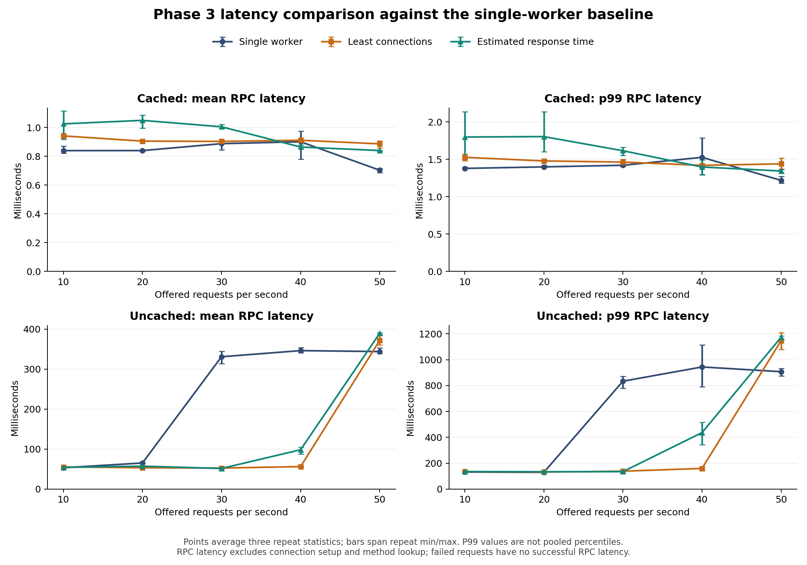
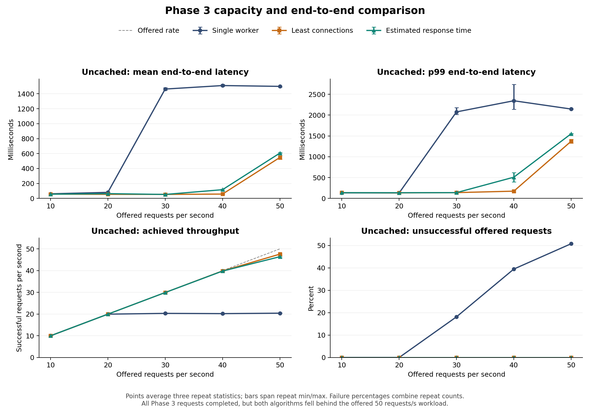

# Phase 3 benchmark comparison

## Scope and method

The single-worker Phase 2 baseline is compared with three workers behind a TCP load balancer using least connections or estimated response time. Each configuration ran at 10, 20, 30, 40, and 50 offered requests per second, for 30 seconds per workload and three repeats, in cached and uncached modes. Each configuration offered 27,000 requests in total.

The saved settings match for rate, duration, repeats, cache mode, client workers (32), maximum pending requests (128), and random seed (2026). Document hashes, package versions, Python version, and the recorded container platform also match. The benchmark, counting, cache, client, and plotting module hashes are identical across all three runs; the server changed between Phases 2 and 3. The Phase 3 metadata records identical source hashes for both algorithm runs.

The baseline was recorded on 17 November 2026; the two Phase 3 runs were recorded sequentially on 19 November 2026. Labels and the recorded execution commands identify the algorithms. The metadata does not independently capture the balancer's effective algorithm or all deployment settings. Matching recorded workloads does not establish identical host load or runtime resource conditions.

Tables report the arithmetic mean of the three repeat statistics, rather than pooled request-level statistics. In particular, each reported p99 is the mean of three per-repeat p99 values, not the p99 of all requests combined. Error bars show the repeat minimum and maximum. Failure percentages use summed failures divided by summed offered requests.

`mean_rpc_ms` and `p99_rpc_ms` measure count-RPC invocation to receipt, excluding connection setup and method lookup. End-to-end statistics use the benchmark's separately recorded end-to-end columns. Neither latency measure includes the separately recorded scheduled-start lag. These timings describe successful requests and should be read alongside failure counts and achieved throughput. Raw request traces were not included in the comparison upload; no pooled percentile or independent timing-boundary audit was performed.

## Validation

Each input summary contains the expected 30 workload/repeat rows. Every row satisfies offered = successful + failed, and the reported worker totals sum to successful requests. All three configurations report zero cache-condition mismatches.

| Configuration | Offered | Successful | Unsuccessful |
|---|---:|---:|---:|
| Single worker | 27,000 | 22,804 | 4,196 |
| Least connections | 27,000 | 27,000 | 0 |
| Estimated response time | 27,000 | 27,000 | 0 |

All cached requests succeeded in every configuration. All unsuccessful baseline requests occurred in uncached mode at offered rates of 30 requests/s or higher. For these baseline rows, `sent` equals `successful`; the unsuccessful offered requests were not counted as sent. The summaries alone do not identify their precise rejection or scheduling mechanism, so they should not be described as worker crashes or failed RPCs.

## RPC latency

### Cached workloads

| Configuration | Rate (req/s) | Mean RPC (ms) | Mean repeat p99 RPC (ms) |
|---|---:|---:|---:|
| Single worker | 10 | 0.84 | 1.38 |
| Least connections | 10 | 0.94 | 1.53 |
| Estimated response time | 10 | 1.03 | 1.80 |
| Single worker | 20 | 0.84 | 1.40 |
| Least connections | 20 | 0.91 | 1.48 |
| Estimated response time | 20 | 1.05 | 1.80 |
| Single worker | 30 | 0.89 | 1.42 |
| Least connections | 30 | 0.90 | 1.46 |
| Estimated response time | 30 | 1.01 | 1.61 |
| Single worker | 40 | 0.90 | 1.53 |
| Least connections | 40 | 0.91 | 1.42 |
| Estimated response time | 40 | 0.86 | 1.40 |
| Single worker | 50 | 0.70 | 1.22 |
| Least connections | 50 | 0.89 | 1.44 |
| Estimated response time | 50 | 0.84 | 1.34 |

Cached mean RPC latencies remain around 0.70-1.05 ms, with small differences that vary by rate and configuration. Cached mean end-to-end latency is higher with either balancer at every tested rate. All configurations achieved the offered cached rate with no failures. For this workload, replication provided no observed throughput benefit within the tested range. The extra proxy path and metrics work are plausible contributors to overhead, but these experiments do not isolate their individual costs.

### Uncached workloads

| Configuration | Rate (req/s) | Mean RPC (ms) | Mean repeat p99 RPC (ms) |
|---|---:|---:|---:|
| Single worker | 10 | 53.44 | 131.89 |
| Least connections | 10 | 55.45 | 135.36 |
| Estimated response time | 10 | 54.41 | 135.33 |
| Single worker | 20 | 65.22 | 128.99 |
| Least connections | 20 | 53.44 | 131.32 |
| Estimated response time | 20 | 57.27 | 133.97 |
| Single worker | 30 | 331.05 | 833.82 |
| Least connections | 30 | 52.58 | 138.18 |
| Estimated response time | 30 | 51.58 | 134.63 |
| Single worker | 40 | 346.38 | 943.97 |
| Least connections | 40 | 56.24 | 159.60 |
| Estimated response time | 40 | 98.39 | 436.29 |
| Single worker | 50 | 344.03 | 907.52 |
| Least connections | 50 | 371.86 | 1146.82 |
| Estimated response time | 50 | 389.79 | 1173.58 |

At 10 requests/s, RPC latencies are close across configurations. At 30 and 40 requests/s, both three-worker configurations have lower mean RPC latency and lower mean repeat p99 than the single-worker baseline, while also completing every offered request.

At 40 uncached requests/s, least connections records 56.24 ms mean RPC latency and 159.60 ms mean repeat p99, compared with 98.39 ms and 436.29 ms for estimated response time. Least connections therefore performed better on this recorded workload. This is a comparison of two sequential runs, not evidence that it always outperforms response-time routing.

At 50 uncached requests/s, the baseline's successful-only mean and p99 RPC latencies are lower than those of both Phase 3 configurations, but it completes only 2,215 of 4,500 offered requests. It would be misleading to infer better overall service from those latency values alone. Both three-worker configurations complete all 4,500 requests, with increased latency and scheduling lag.

## Throughput, unsuccessful requests, and end-to-end latency

| Configuration | Rate (req/s) | Achieved req/s | Unsuccessful (%) | Mean end-to-end (ms) | Mean repeat p99 end-to-end (ms) |
|---|---:|---:|---:|---:|---:|
| Single worker | 10 | 9.99 | 0.00 | 61.38 | 132.85 |
| Least connections | 10 | 9.99 | 0.00 | 56.99 | 137.11 |
| Estimated response time | 10 | 9.99 | 0.00 | 56.25 | 136.94 |
| Single worker | 20 | 19.95 | 0.00 | 80.57 | 131.72 |
| Least connections | 20 | 19.95 | 0.00 | 54.70 | 132.54 |
| Estimated response time | 20 | 19.95 | 0.00 | 63.80 | 136.27 |
| Single worker | 30 | 20.32 | 18.15 | 1463.62 | 2077.48 |
| Least connections | 30 | 29.91 | 0.00 | 53.78 | 139.24 |
| Estimated response time | 30 | 29.91 | 0.00 | 52.98 | 138.44 |
| Single worker | 40 | 20.20 | 39.47 | 1510.47 | 2345.16 |
| Least connections | 40 | 39.85 | 0.00 | 57.92 | 173.78 |
| Estimated response time | 40 | 39.78 | 0.00 | 116.63 | 509.22 |
| Single worker | 50 | 20.40 | 50.78 | 1499.51 | 2146.12 |
| Least connections | 50 | 47.58 | 0.00 | 547.73 | 1372.25 |
| Estimated response time | 50 | 46.40 | 0.00 | 606.21 | 1552.45 |

The single worker's achieved uncached throughput levels off near 20 requests/s at offered rates of 30–50 requests/s. Its unsuccessful fractions are 18.15%, 39.47%, and 50.78%, respectively. Both load-balancing configurations complete all requests at those offered rates, improving the observed capacity of the deployment.

At the offered rate of 50 requests/s, achieved throughput is 47.58 requests/s for least connections and 46.40 for estimated response time. Their mean repeat p99 scheduled-start lags rise to 880.12 ms and 1,634.70 ms. Completion continues beyond the nominal workload window, so zero failures does not establish that either system sustains 50 requests/s without accumulating a backlog. No threefold speedup claim is supported.

## Request distribution and the slow-worker experiments

The benchmark's least-connections cached workloads split requests equally across the three workers. Its uncached split varies as requests overlap. Estimated-response-time routing produces unequal distributions, especially for short cached requests; equal allocation is not the criterion for that algorithm.

Separate terminal evidence collected before these benchmarks records a deliberately slow worker 1. Estimated response time sent 5, 42, and 13 queries to workers 1, 2, and 3. Least connections, tested using three concurrent clients, sent combined totals of 7, 26, and 27. Both distributions are consistent with avoiding the slower worker. These slow-worker workloads had different concurrency, so their counts cannot rank algorithm performance. Those logs remain in `docs/evidence/phase3/` and are not part of the uploaded benchmark summaries.

## Phase 4 baseline

The earlier worker-stop test had worker health monitoring disabled. Worker 1's connection-failure counter increased, and the client received an EOFError and exited before completing 60 requests. Restarting worker 1 allowed a subsequent test to complete 60 requests, split 20 per worker. This documents the pre-fault-tolerance limitation and restoration of service after restart; it does not demonstrate automatic exclusion of failed workers or transparent retry.

Phase 4 will add or enable periodic worker checks, route new connections to healthy workers, detect recovery, and verify exclusion and rejoining for both algorithms. Bounded client retries belong to the agreed fault-tolerance work. A TCP proxy must not replay an arbitrary partially forwarded RPyC stream as if it were a fresh application request.

## Evidence files

`evidence/phase3/benchmarks/` contains the original summary and metadata for each run, a calculated `comparison.csv`, and the two comparison figures. The original per-request measurements remain in the project's `results/` directories. This comparison verifies the supplied benchmark evidence; it is not a source-code review or an automated-test report.
