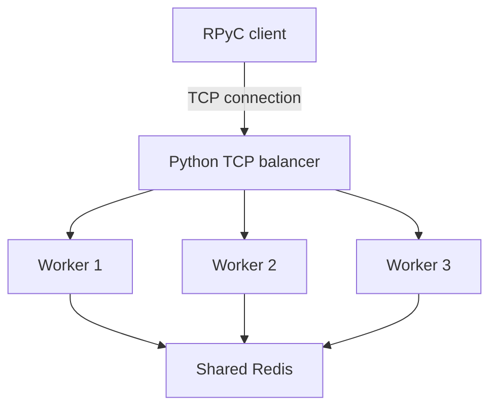

# Phase 3, first increment: three workers and a TCP proxy

This increment adds three explicitly named worker services and the first of the two planned load-balancing algorithms. Phase 3 is not complete until estimated least response time and the comparison experiments are implemented, run, and documented.

The existing `compose.yaml`, source modules, requirements, Phase 2 results, and `phase-2` tag are preserved. The new standalone deployment file is `compose.phase3.yaml`; pass it with `-f` for every Phase 3 command.

## Architecture



Every worker reads the same `data` directory through a read-only mount. Workers have distinct IDs but run the existing server code. There is one shared Redis cache. Result identity depends on content and counting-rule version, so any worker can reuse another worker's cached count.

No automatic Docker worker replication is used. `server1`, `server2`, and `server3` are separate Compose service definitions. YAML anchors reuse their common configuration without creating additional replicas or a built-in traffic balancer.

## Algorithm

For each new client connection, select the worker with the fewest active proxied connections. Rotate between workers when counts are equal. Increment the chosen worker's count before attempting its upstream connection, and decrement it when that proxied session is cleaned up, including connection failures or cancellation.

Selection and increment run without an intervening `await` in one asyncio event loop. Therefore two concurrent handlers cannot both select using the same stale local counters. These counters belong to this one balancer; future multiple balancers would each have their own local view.

Least connections is dynamic because it uses the current active counts. With sequential short queries, counts often return to zero, and the rotating tie-breaker can resemble round robin. A sequential distribution demo establishes reachability and tie behavior, not a complete dynamic-load evaluation. Unit tests explicitly exercise unequal active counts; later experiments will examine concurrent workloads.

## TCP forwarding

The balancer opens one TCP connection to the selected worker and forwards bytes in both directions using asyncio streams. It does not import RPyC, call worker RPC methods, inspect keywords, or parse RPC message boundaries. The client and worker remain the RPyC endpoints.

Read EOF is propagated as a half-close where supported, so data can still flow in the other direction. `drain()` applies output-buffer backpressure. Buffers are read in chunks of at most 65,536 bytes. The upstream connection timeout is 3 seconds; the maximum proxied session lifetime is 120 seconds, not an inactivity timeout. This limit suits the current one-query-per-connection experiment. It would need reconsideration for long-lived clients.

Connection lifetime, not individual RPC method execution, is counted. A persistent connection stays pinned to one worker for all its calls. A worker failure can interrupt the session; this increment does not retry calls or remove failed workers from the candidate pool.

## Status and monitoring boundary

The internal HTTP endpoint on port 18862 exposes `/status` with algorithm name, active connections, cumulative selections, and upstream-connect failures. It is used by the balancer's Compose health check. It does not open proxied worker connections, preventing health checks from contaminating worker-selection counts.

This is balancer status, not worker health monitoring. Worker application pings remain separate Docker health checks. Docker marks a worker unhealthy if its ping fails, but this Python balancer does not consume that status. Automatic exclusion and re-admission belong to Phase 4.

The status endpoint and data ports are not published to the laptop. The balancer's readiness does not imply that every future worker query will succeed.

## Install the increment

Add these files to the existing repository:

- `wordcount/load_balancer.py`
- `wordcount/balancer_status.py`
- `wordcount/check_distribution.py`
- `tests/test_load_balancer.py`
- `compose.phase3.yaml`
- This document under `docs/`.

The existing Dockerfile copies new modules into the application image. No previous Python implementation file is replaced.

## Start

Stop the Phase 2 deployment before using the same Compose project for Phase 3:

```bash
docker compose down
docker compose -f compose.phase3.yaml config
docker compose -f compose.phase3.yaml up --build -d --wait redis server1 server2 server3 balancer
docker compose -f compose.phase3.yaml ps
```

Stopping Redis clears its temporary cache and keyword statistics in this lab configuration. Saved measurements and repository files are not removed. Expect five running healthy services: Redis, three workers, and the balancer.

## Query through the balancer

```bash
docker compose -f compose.phase3.yaml run --rm client query alice rabbit
```

The client service's entrypoint already supplies `--host balancer --port 18860`. The count should match the Phase 2 result for the same book. The returned `server_id` identifies the selected worker.

Exercise nine separate client connections:

```bash
docker compose -f compose.phase3.yaml run --rm distribution --requests 9
```

The helper computes a local expected count and verifies each remote result. It prints worker IDs and a total for each observed worker. All three should normally appear; exact counts need not be identical because connection cleanup and concurrent connections can affect selection. The earlier manual query also affects cumulative balancer counters, but not the helper's nine-query totals.

Inspect routing decisions and status:

```bash
docker compose -f compose.phase3.yaml logs --tail=40 balancer
docker compose -f compose.phase3.yaml exec balancer python -m wordcount.balancer_status --host 127.0.0.1
```

`selected_connections` counts proxied sessions, not necessarily successful application queries. `active_connections` can briefly remain nonzero while a session is closing. Save a readable terminal screenshot of the distribution output and relevant routing logs for Phase 3 evidence.

## Tests

```bash
docker run --rm --mount "type=bind,source=$PWD,target=/app,readonly" -w /app wordcount-lab:phase3 python -B -m unittest discover -s tests -v
```

Expected: 41 passing tests, consisting of the existing 33 and eight new selection/proxy tests. The proxy tests cover least-active selection, rotating ties, binary forwarding, half-close behavior, failure cleanup, session limits, status isolation, and real RPyC calls reaching three workers.

Development verification used local TCP sockets and Python processes. Docker Compose runtime behavior must be verified on the laptop. No Phase 3 performance result is claimed yet.

Commit after the laptop checks pass:

```text
feat(phase-3): add three workers and least-connections TCP balancing
```

Do not create the `phase-3` tag yet. Wait for the second algorithm and comparison experiments. Do not run the full Phase 3 benchmark until its labels and comparison workflow have been updated for both algorithms.

## Return to Phase 2

```bash
docker compose -f compose.phase3.yaml down
docker compose up --build -d --wait redis server
```

The original baseline configuration remains usable without modifying Phase 3 files.
